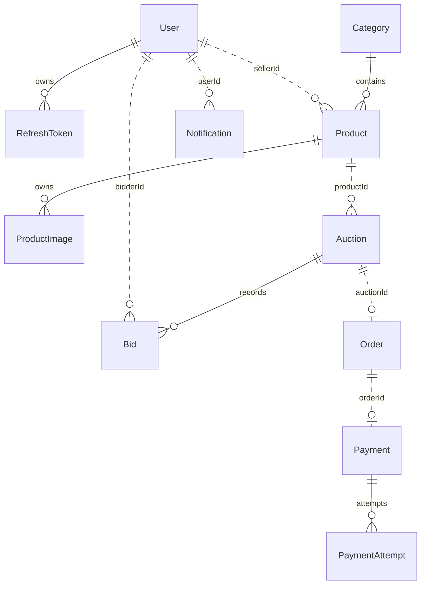

# Thiết kế dữ liệu — baseline Phase 1

Mỗi database có role sở hữu riêng. FK chỉ trong cùng service. Dữ liệu tham chiếu service khác là ID, không có cross-database join. ID lưu TEXT chứa UUID để giữ tương thích Auth cũ. Tiền Decimal(18,2), API/event dùng string nguyên đồng; thời gian ISO UTC.

## Ràng buộc SQL ngoài Prisma

- Auction: một phiên INITIALIZING/PENDING/ACTIVE trên mỗi product; endTime > startTime, giá dương và currentPrice >= startingPrice.
- ProductImage: tối đa một ảnh primary trên mỗi product.
- PaymentAttempt: tối đa một attempt PENDING trên mỗi payment.
- Order/Payment/Bid: amount dương.
- Auth: role text được cast sang enum, giữ role cũ; refresh token được hash và revoke session cũ khi chuyển phiên bản.

## Models theo service

### auth — auth_db

```prisma
datasource db {
 provider = "postgresql"
 url = env("AUTH_DATABASE_URL")
}
generator client {
 provider = "prisma-client-js"
 output = "../../../node_modules/@prisma/client/auth"
}
enum UserRole {
 USER
 SELLER
 ADMIN
}
enum AuthProvider {
 LOCAL
 GOOGLE
}
model User {
 id String @id @default(uuid())
 email String @unique
 password String?
 name String
 avatarUrl String?
 role UserRole @default(USER)
 provider AuthProvider @default(LOCAL)
 googleId String? @unique
 isActive Boolean @default(true)
 isEmailVerified Boolean @default(false)
 refreshTokens RefreshToken[]
 createdAt DateTime @default(now())
 updatedAt DateTime @updatedAt
}
model RefreshToken {
 id String @id @default(uuid())
 tokenHash String @unique
 jti String @unique
 familyId String
 userId String
 user User @relation(fields: [userId], references: [id], onDelete: Cascade)
 isRevoked Boolean @default(false)
 expiresAt DateTime
 createdAt DateTime @default(now())
 @@index([userId, familyId])
}
model PlatformProbe {
  id String @id @default(uuid())
  runId String
  kind String
  data Json
  createdAt DateTime @default(now())
  @@unique([runId, kind])
}
```

### product — product_db

```prisma
datasource db {
 provider = "postgresql"
 url = env("PRODUCT_DATABASE_URL")
}
generator client {
 provider = "prisma-client-js"
 output = "../../../node_modules/@prisma/client/product"
}
enum ProductStatus {
 DRAFT
 READY
 RESERVED
 IN_AUCTION
 SOLD
}
enum ProductCondition {
 NEW
 USED
 LIKE_NEW
}
model Category {
 id String @id @default(uuid())
 name String @unique
 description String?
 products Product[]
 createdAt DateTime @default(now())
}
model Product {
 id String @id @default(uuid())
 sellerId String
 categoryId String
 category Category @relation(fields: [categoryId], references: [id], onDelete: Restrict)
 title String
 description String
 condition ProductCondition @default(NEW)
 status ProductStatus @default(DRAFT)
 reservedAuctionId String? @unique
 reservationSnapshot Json?
 lastAuctionVersion Int @default(0)
 images ProductImage[]
 createdAt DateTime @default(now())
 updatedAt DateTime @updatedAt
 @@index([sellerId, createdAt])
 @@index([categoryId, status])
}
model ProductImage {
 id String @id @default(uuid())
 productId String
 product Product @relation(fields: [productId], references: [id], onDelete: Cascade)
 url String
 isPrimary Boolean @default(false)
 createdAt DateTime @default(now())
 @@index([productId])
}
model PlatformProbe {
  id String @id @default(uuid())
  runId String
  kind String
  data Json
  createdAt DateTime @default(now())
  @@unique([runId, kind])
}
model ProcessedEvent {
  consumerName String
  eventId String
  processedAt DateTime @default(now())
  @@id([consumerName, eventId])
}
```

### auction — auction_db

```prisma
datasource db {
 provider = "postgresql"
 url = env("AUCTION_DATABASE_URL")
}
generator client {
 provider = "prisma-client-js"
 output = "../../../node_modules/@prisma/client/auction"
}
enum AuctionStatus {
 INITIALIZING
 PENDING
 ACTIVE
 ENDED
 CANCELLED
}
model Auction {
 id String @id @default(uuid())
 productId String
 sellerId String
 productTitle String?
 productThumbnail String?
 startingPrice Decimal @db.Decimal(18,2)
 currentPrice Decimal @db.Decimal(18,2)
 bidIncrement Decimal @db.Decimal(18,2)
 currency String @default("VND")
 startTime DateTime
 endTime DateTime
 status AuctionStatus @default(INITIALIZING)
 leadingBidderId String?
 winnerId String?
 finalPrice Decimal? @db.Decimal(18,2)
 version Int @default(0)
 initializationRequest Json
 initializationError String?
 bids Bid[]
 createdAt DateTime @default(now())
 updatedAt DateTime @updatedAt
 @@index([status, endTime])
 @@index([status, startTime])
 @@index([sellerId, createdAt])
 @@index([productId, createdAt])
}
model Bid {
 id String @id @default(uuid())
 auctionId String
 auction Auction @relation(fields: [auctionId], references: [id], onDelete: Restrict)
 bidderId String
 amount Decimal @db.Decimal(18,2)
 createdAt DateTime @default(now())
 @@index([auctionId, createdAt])
}
model PlatformProbe {
  id String @id @default(uuid())
  runId String
  kind String
  data Json
  createdAt DateTime @default(now())
  @@unique([runId, kind])
}
model OutboxEvent {
  id String @id
  aggregateId String
  aggregateVersion Int
  exchange String
  routingKey String
  envelope Json
  status String @default("PENDING")
  attempts Int @default(0)
  availableAt DateTime @default(now())
  leaseUntil DateTime?
  leaseOwner String?
  lastError String?
  createdAt DateTime @default(now())
  sentAt DateTime?
  @@unique([aggregateId, aggregateVersion])
  @@index([status, availableAt])
}
model IdempotencyRecord {
  id String @id @default(uuid())
  actorId String
  operation String
  key String
  requestHash String
  response Json?
  statusCode Int?
  createdAt DateTime @default(now())
  @@unique([actorId, operation, key])
}
```

### order — order_db

```prisma
datasource db {
 provider = "postgresql"
 url = env("ORDER_DATABASE_URL")
}
generator client {
 provider = "prisma-client-js"
 output = "../../../node_modules/@prisma/client/order"
}
enum OrderStatus {
 PENDING_PAYMENT
 PAID
 CANCELLED
 COMPLETED
}
model Order {
 id String @id @default(uuid())
 auctionId String @unique
 productId String
 buyerId String
 sellerId String
 totalAmount Decimal @db.Decimal(18,2)
 currency String @default("VND")
 status OrderStatus @default(PENDING_PAYMENT)
 productTitle String
 productThumbnail String?
 paymentId String? @unique
 paidAt DateTime?
 createdAt DateTime @default(now())
 updatedAt DateTime @updatedAt
 @@index([buyerId, createdAt])
 @@index([sellerId, createdAt])
}
model PlatformProbe {
  id String @id @default(uuid())
  runId String
  kind String
  data Json
  createdAt DateTime @default(now())
  @@unique([runId, kind])
}
model ProcessedEvent {
  consumerName String
  eventId String
  processedAt DateTime @default(now())
  @@id([consumerName, eventId])
}
```

### payment — payment_db

```prisma
datasource db {
 provider = "postgresql"
 url = env("PAYMENT_DATABASE_URL")
}
generator client {
 provider = "prisma-client-js"
 output = "../../../node_modules/@prisma/client/payment"
}
enum PaymentStatus {
 PENDING
 SUCCESS
 FAILED
 EXPIRED
}
enum PaymentMethod {
 COD
 VNPAY
}
model Payment {
 id String @id @default(uuid())
 orderId String @unique
 userId String
 amount Decimal @db.Decimal(18,2)
 currency String @default("VND")
 status PaymentStatus @default(PENDING)
 paidAt DateTime?
 attempts PaymentAttempt[]
 createdAt DateTime @default(now())
 updatedAt DateTime @updatedAt
 @@index([userId, createdAt])
}
model PaymentAttempt {
 id String @id @default(uuid())
 paymentId String
 payment Payment @relation(fields: [paymentId], references: [id], onDelete: Restrict)
 paymentMethod PaymentMethod
 providerReference String @unique
 transactionId String? @unique
 status PaymentStatus @default(PENDING)
 expiresAt DateTime
 paidAt DateTime?
 providerResponse Json?
 createdAt DateTime @default(now())
 updatedAt DateTime @updatedAt
 @@index([paymentId, createdAt])
}
model PlatformProbe {
  id String @id @default(uuid())
  runId String
  kind String
  data Json
  createdAt DateTime @default(now())
  @@unique([runId, kind])
}
model OutboxEvent {
  id String @id
  aggregateId String
  aggregateVersion Int
  exchange String
  routingKey String
  envelope Json
  status String @default("PENDING")
  attempts Int @default(0)
  availableAt DateTime @default(now())
  leaseUntil DateTime?
  leaseOwner String?
  lastError String?
  createdAt DateTime @default(now())
  sentAt DateTime?
  @@unique([aggregateId, aggregateVersion])
  @@index([status, availableAt])
}
model IdempotencyRecord {
  id String @id @default(uuid())
  actorId String
  operation String
  key String
  requestHash String
  response Json?
  statusCode Int?
  createdAt DateTime @default(now())
  @@unique([actorId, operation, key])
}
```

### notification — notification_db

```prisma
datasource db {
 provider = "postgresql"
 url = env("NOTIFICATION_DATABASE_URL")
}
generator client {
 provider = "prisma-client-js"
 output = "../../../node_modules/@prisma/client/notification"
}
enum NotificationType {
 OUTBID
 AUCTION_WON
 AUCTION_ENDED
 PAYMENT_SUCCESS
}
model Notification {
 id String @id @default(uuid())
 userId String
 sourceEventId String
 title String
 message String
 type NotificationType
 isRead Boolean @default(false)
 metadata Json
 createdAt DateTime @default(now())
 @@unique([sourceEventId, userId, type])
 @@index([userId, createdAt])
}
model PlatformProbe {
  id String @id @default(uuid())
  runId String
  kind String
  data Json
  createdAt DateTime @default(now())
  @@unique([runId, kind])
}
model ProcessedEvent {
  consumerName String
  eventId String
  processedAt DateTime @default(now())
  @@id([consumerName, eventId])
}
```

## Upgrade database cũ

Bootstrap chỉ xử lý sáu database đã biết. Nếu database đang thuộc POSTGRES_USER do khung cũ tạo, ownership của database/bảng/sequence/enum public được chuyển sang role service trước khi migrate. Không xóa dữ liệu hoặc tự đổi password role đã tồn tại. Nếu credential và role thực tế không khớp, sửa credential có chủ đích, không reset volume.

## ERD tổng quan

Nét liền là FK nội bộ; nét đứt là tham chiếu logic. Product–Auction là lịch sử một-nhiều; partial index chỉ giới hạn phiên đang mở. Shadow database dành riêng cho migration dev, không phải bounded context bổ sung.


